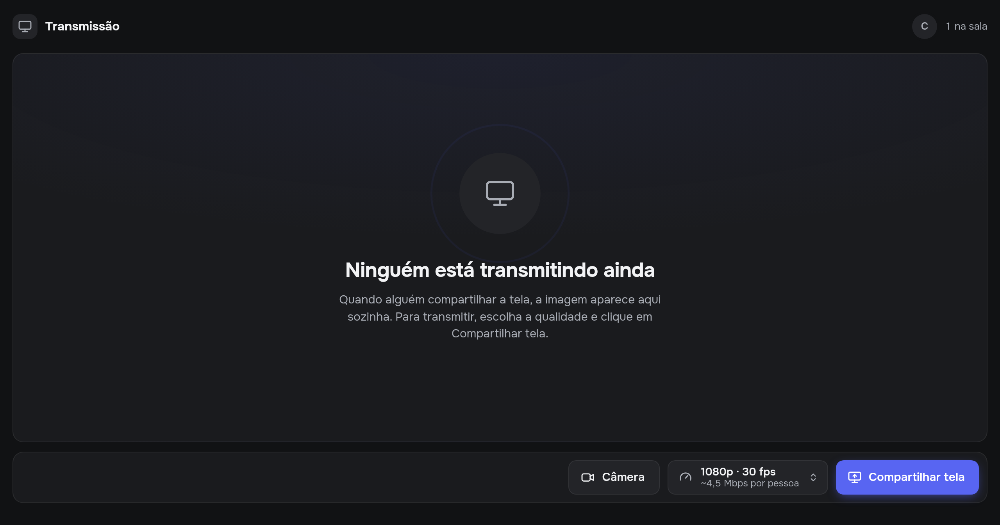
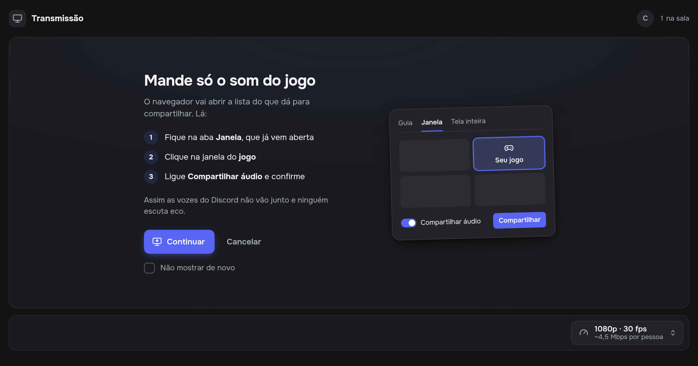

<p align="center"></p>

**rhut** é transmissão de tela para o seu servidor do Discord, direto no navegador. Site: <https://rhut.storell.dev.br>

Alguém digita `/live`, o bot posta um aviso no canal e todo mundo entra numa sala na web. Até 4 pessoas compartilham a janela do jogo com o som dela ao mesmo tempo, e o resto escolhe o que assistir, com atraso baixo, em até 1080p a 60 fps. O vídeo vai direto de um navegador para o outro (WebRTC), sem passar por servidor, e tudo roda no plano gratuito da Cloudflare. Para salas maiores, dá para ligar o SFU da Cloudflare, e aí quem transmite manda uma cópia só.



## Por que existe

O compartilhamento de tela do próprio Discord limita a qualidade para quem não tem Nitro. Este projeto é a alternativa para grupos pequenos de amigos: 1080p a 60 fps sem assinatura, com controle sobre a qualidade e sem instalar nada, porque tudo acontece numa aba do navegador.

## O que tem

- **Comando `/live`**: cria a sala e posta um aviso no canal que acompanha o estado dela (aberta, ao vivo). Quando a sala fecha, o aviso sai do canal, então avisos velhos não se acumulam na conversa. Quem digita o comando não recebe confirmação nenhuma: o próprio aviso é a confirmação, e só aparece mensagem se der erro.
- **Painel de salas**: quem pode gerenciar canais digita `/painel` num canal (de preferência um só para isso) e o bot fixa ali uma mensagem com as salas abertas e o botão **Abrir sala**. Com o painel, toda sala aparece nele, mesmo as abertas por `/live` em outro canal, e a lista se atualiza sozinha: aberta, ao vivo, e some quando a sala fecha. Com mais de 4 salas, as que não cabem em botões vão para o menu **Entrar em outra sala**. Rodar `/painel` em outro canal muda o painel de lugar.
- **Quem está e em qual call**: o aviso e o painel mostram quem está transmitindo, quantas pessoas estão assistindo e a call de voz de quem abriu a sala (e, depois, de quem começou a transmitir), com um botão **Ir para a call**.
- **Entrar com um clique** (opcional): com o login pelo Discord ligado, o **Entrar** abre a sala direto. Na primeira vez, o Discord pergunta se o rhut pode saber quem é você; depois, a sala abre com o seu nome e a sua foto do servidor, sem mensagem de link no chat.
- **Várias telas ao mesmo tempo**: até 4 pessoas transmitem na mesma sala, cada tela num card, como numa chamada do Discord. Ninguém recebe uma tela sem escolher (o card mostra o convite **Assistir**), clicar num card deixa ele em destaque, e dá para transmitir e assistir ao mesmo tempo.
- **Só o som do jogo, tratado como som de jogo**: compartilhando a janela do jogo, vai só o áudio dela. Ele sai em estéreo a 160 kbps, no modo de música do Opus (não no de voz), com FEC para aguentar perda de pacote, sem cortar trechos baixos e com prioridade sobre o vídeo quando o upload aperta. Antes de abrir a escolha do navegador, a página mostra um passo a passo rápido.
- **Qualidade ajustável**: 720p30, 1080p30, 1080p60 e um modo "Texto nítido" para código e slides. Dá para trocar no meio da transmissão, sem reconectar ninguém.
- **Diagnóstico real**: quem transmite vê a resolução, o FPS e o codec que estão saindo de verdade, e um aviso quando a CPU ou o upload estão no limite. Quem assiste vê o atraso estimado.
- **Câmeras**: qualquer pessoa pode ligar a câmera, que vira mais um card da chamada. No celular, dá para virar entre a câmera da frente e a de trás.
- **Reações**: um clique e o emoji sobe pela tela de todo mundo, com o nome de quem mandou.
- **Quem está na sala**: nome e avatar do Discord de cada pessoa, sem tela de login. Também avisa quando alguém entra ou começa a transmitir.
- **Visual do servidor**: nome e ícone do servidor na página, com a cor de destaque tirada do próprio ícone.
- **Player completo em cada tela**: volume até 200%, tela cheia e modo ambiente (as cores da tela em destaque se espalham em volta do palco).
- **SFU opcional**: com o SFU do Cloudflare Realtime configurado, quem transmite manda uma cópia só da tela e o SFU entrega a quem assiste, em vez de uma cópia por pessoa saindo do PC de quem transmite.



## Como funciona

```
/live no Discord ──> Worker (Cloudflare) posta o aviso com o link da sala
                          │
   quem transmite <── sinalização (WebSocket / Durable Object) ──> quem assiste
          └──────────── vídeo direto, navegador <-> navegador ────────────┘
                     (ou, com o SFU ligado: navegador -> SFU -> quem assiste)
```

- **Bot sem servidor ligado**: o Discord chama o Worker por HTTP (Interactions Endpoint) só quando alguém usa o comando ou clica num botão. Não existe processo rodando 24 horas.
- **Um painel por servidor**: outro Durable Object guarda onde o painel está e quais salas estão abertas. Cada sala avisa esse objeto quando muda de estado, e ele edita a mesma mensagem.
- **Uma sala, um Durable Object**: ele faz só a apresentação entre os navegadores (offer, answer e candidates) e guarda o estado do aviso. O vídeo nunca passa por ele. Só quem está transmitindo pode oferecer a própria tela, e só quem está com a câmera ligada pode oferecer a câmera, então ninguém troca a imagem que os outros estão vendo.
- **Pedir para assistir**: em P2P, quem escolhe assistir pede a tela a quem transmite, que abre uma conexão só para essa pessoa. Pelo SFU, quem transmite publica as trilhas uma vez e anuncia os nomes na sala, e quem escolhe assistir puxa por esses nomes. O Worker repassa as chamadas ao SFU, porque o navegador não pode ter o segredo do app: só cria sessão quem está conectado na sala, e cada sessão só aceita mudanças de quem a criou.
- **Identidade**: com o login pelo Discord ligado, o **Entrar** é um link direto. Na primeira vez a pessoa autoriza o rhut (só o escopo `identify`) e ganha um cookie assinado (HMAC) que vale 30 dias; nome e avatar do servidor vêm do bot. Sem o login ligado, o botão "Entrar na sala" diz ao bot quem clicou, e ele responde só para essa pessoa com um link assinado que vale para aquela sala por 12 horas. Quem abre a sala sem nenhum dos dois (link copiado, cancelou a autorização) entra como "Convidado".
- **Codec em hardware**: como quem transmite codifica uma cópia para cada pessoa, a página põe na frente o codec que a GPU consegue codificar (AV1, H.264 ou VP9).
- **Quem fecha a sala**: o botão **Fechar sala** (ou **Fechar**, no painel) funciona para quem está conectado na sala e para admins do servidor, mesmo de fora dela.
- **Fechamento automático**: a sala vazia por 15 minutos fecha sozinha e tira o aviso do canal.
- **Quedas rápidas não derrubam a sala**: se a conexão de alguém cair (Wi-Fi oscilou, celular trocou de rede, página recarregada), a página reconecta sozinha e a sala espera até 20 segundos antes de dar a pessoa como saída. Se quem transmite volta nesse tempo, a transmissão continua para todo mundo. Se a conexão de vídeo cair, quem assiste pede uma nova automaticamente.

## Instalação

Você vai precisar de uma conta gratuita na [Cloudflare](https://dash.cloudflare.com/sign-up), de um app no [portal de desenvolvedores do Discord](https://discord.com/developers/applications) e do Node.js 22 ou mais novo.

### 1. Criar o app no Discord

1. No portal de desenvolvedores, clique em **New Application**.
2. Em **General Information**, copie o **Application ID** e a **Public Key**.
3. Em **Bot**, clique em **Reset Token** e copie o token.
4. Adicione o bot ao servidor por este link, trocando `SEU_APPLICATION_ID`. Ele pede as permissões de ver canal, enviar mensagens e inserir links:

   ```
   https://discord.com/oauth2/authorize?client_id=SEU_APPLICATION_ID&scope=bot+applications.commands&permissions=19456
   ```

### 2. Publicar na Cloudflare

```sh
git clone https://github.com/SauloStorel/rhut.git
cd rhut
npm install
npx wrangler login
npx wrangler deploy
```

O deploy mostra a URL do Worker, algo como `https://rhut.SEU-USUARIO.workers.dev`. Depois cadastre os segredos:

```sh
npx wrangler secret put DISCORD_PUBLIC_KEY   # a Public Key do passo 1
npx wrangler secret put DISCORD_BOT_TOKEN    # o token do bot
openssl rand -hex 32 | npx wrangler secret put SESSION_SECRET
```

### 3. Ligar o Discord ao Worker

1. No portal do Discord, em **General Information > Interactions Endpoint URL**, coloque `https://rhut.SEU-USUARIO.workers.dev/interactions` e salve. O Discord testa a URL na hora.
2. Cadastre os comandos `/live` e `/painel`:

   ```sh
   cp .env.example .env   # preencha DISCORD_APPLICATION_ID e DISCORD_BOT_TOKEN
   npm run register
   ```

Pronto. Digite `/live` em qualquer canal do servidor, ou `/painel` no canal onde as salas devem ficar.

O bot não lê as mensagens do canal, então não percebe quando a conversa empurra o painel para cima. Para ele ficar sempre à vista, use um canal onde só o bot escreve.

### 4. Entrar com um clique (opcional)

Com isso ligado, o **Entrar** abre a sala direto, sem o bot mandar um link pessoal no chat:

1. No portal do Discord, em **OAuth2 > Redirects**, adicione `https://rhut.SEU-USUARIO.workers.dev/auth/callback` e salve.
2. Ainda em **OAuth2**, copie o **Client Secret** (clique em **Reset Secret** se ele não aparecer).
3. Cadastre o Application ID e o Client Secret:

   ```sh
   npx wrangler secret put DISCORD_APPLICATION_ID
   npx wrangler secret put DISCORD_CLIENT_SECRET
   ```

Salas abertas antes disso continuam com o "Entrar" antigo até fecharem.

### 5. SFU (opcional, para salas maiores)

Sem SFU, quem transmite manda uma cópia da tela para cada pessoa assistindo, e o upload dele define o tamanho da sala. Com o SFU do Cloudflare Realtime, sai uma cópia só, e a Cloudflare entrega a quem assistir. O plano gratuito cobre 1.000 GB de tráfego por mês (divididos com o TURN); depois disso, a Cloudflare cobra US$ 0,05 por GB.

1. No painel da Cloudflare, vá em **Realtime > Serverless SFU**, crie um app e copie o **App ID** e o **App Secret**.
2. Cadastre os dois:

   ```sh
   npx wrangler secret put REALTIME_APP_ID
   npx wrangler secret put REALTIME_APP_SECRET
   ```

Com os dois cadastrados, todas as telas passam a ir pelo SFU (as câmeras continuam em P2P, porque são leves). Sem eles, tudo continua em P2P.

### 6. TURN (opcional)

Sem TURN, a conexão direta funciona na maioria das redes. Se alguém atrás de rede restritiva (alguns 4G, redes de empresa ou faculdade) não conseguir assistir, ative o retransmissor da Cloudflare:

1. No painel da Cloudflare, vá em **Realtime > TURN Server > Create** e copie o **Key ID** e o **API Token**.
2. Cadastre os dois:

   ```sh
   npx wrangler secret put TURN_KEY_ID
   npx wrangler secret put TURN_KEY_API_TOKEN
   ```

## Configuração

| Variável | Onde | Para que serve |
|---|---|---|
| `DISCORD_PUBLIC_KEY` | secret | Confere se as chamadas vêm mesmo do Discord |
| `DISCORD_BOT_TOKEN` | secret | Posta, edita e apaga o aviso e o painel no canal, lê nome e ícone do servidor |
| `SESSION_SECRET` | secret | Assina os links pessoais da sala e o cookie de quem entrou pelo Discord |
| `DISCORD_APPLICATION_ID`, `DISCORD_CLIENT_SECRET` | secret, opcional | Liga o "Entrar" com um clique (login pelo Discord) |
| `REALTIME_APP_ID`, `REALTIME_APP_SECRET` | secret, opcional | Liga o SFU do Cloudflare Realtime para as telas |
| `TURN_KEY_ID`, `TURN_KEY_API_TOKEN` | secret, opcional | Credenciais temporárias de TURN |
| `DEV_ROOMS` | var, só desenvolvimento | `"on"` deixa qualquer link `/r/<id>` abrir uma sala sem `/live` (o `npm run dev` já liga) |
| `ACCENT_COLOR` | `wrangler.jsonc` | `"auto"` tira a cor do ícone do servidor (só na página). Um hex fixo, como `"#e5242b"`, vale também para o aviso no Discord |

## Rodando localmente

```sh
cp .dev.vars.example .dev.vars   # preencha DISCORD_PUBLIC_KEY, DISCORD_BOT_TOKEN e SESSION_SECRET
npm run dev
```

Para abrir uma sala sem passar pelo Discord, use qualquer id de 10 letras minúsculas ou números, por exemplo <http://localhost:8787/r/teste12345>. Isso só funciona em desenvolvimento (o `npm run dev` liga `DEV_ROOMS`); em produção, só abre a sala que o bot criou. Para testar transmitindo e assistindo ao mesmo tempo, abra o link em duas abas.

Antes de mandar alterações, rode `npm run typecheck` (Worker, front e testes) e `npm test` (os testes rodam dentro do workerd, com os Durable Objects de verdade, e simulam o Discord e o SFU).

## Limites

- **Upload de quem transmite**: em P2P, cada pessoa assistindo recebe uma cópia direta. Em 1080p30, conte uns 4,5 Mbps de upload por pessoa. Até 4 ou 5 pessoas fica tranquilo; para mais gente, ligue o SFU (passo 5), e aí sai uma cópia só.
- **Áudio**: mandar só o som da janela depende do Chrome ou Edge 141+ e do sistema operacional oferecer. Escolhendo "Tela inteira", vai o som do PC todo, Discord incluído; a página avisa quando isso acontece.
- **Celular**: assiste normalmente, mas não consegue transmitir.
- **Até 4 telas por sala**: para uma quinta pessoa transmitir, alguém para antes, ou abre outra sala com `/live`. Cada tela assistida também pesa no download de quem assiste.
- **Interface só em português.**

## Estrutura

| Arquivo | O que faz |
|---|---|
| `src/index.ts` | Rotas do Worker |
| `src/discord.ts` | Verifica a assinatura do Discord e trata o `/live` e os botões do aviso |
| `src/announcement.ts` | Monta o aviso do canal para cada estado da sala |
| `src/room.ts` | Durable Object da sala: sinalização, presença e ciclo de vida |
| `src/identity.ts` | Perfil de quem entrou e os links pessoais assinados |
| `src/turn.ts` | Credenciais TURN temporárias |
| `public/room.js` | Página da sala: transmitir e assistir |
| `public/cameras.js` | Câmeras em P2P |
| `public/capture.js` | Captura de tela com o áudio certo para jogos |
| `public/quality.js` | Presets de qualidade e troca ao vivo |
| `public/codecs.js` | Prefere codec com encoder em hardware |
| `public/diagnostics.js` | Resolução, FPS e atraso reais |
| `public/ui/` | Componentes da página: player, presença, seletor, avisos |
| `scripts/register-commands.mjs` | Cadastra o comando `/live` no Discord |

## Contribuindo

Issues e pull requests são bem-vindos. O projeto não usa framework nem etapa de build no front: é HTML, CSS e módulos JavaScript servidos como estão, então dá para mexer sem instalar nada além do Wrangler.

Veja o [guia de contribuição](CONTRIBUTING.md) para o passo a passo. Para relatar uma falha de segurança, siga a [política de segurança](SECURITY.md).

## Licença

[MIT](LICENSE)
